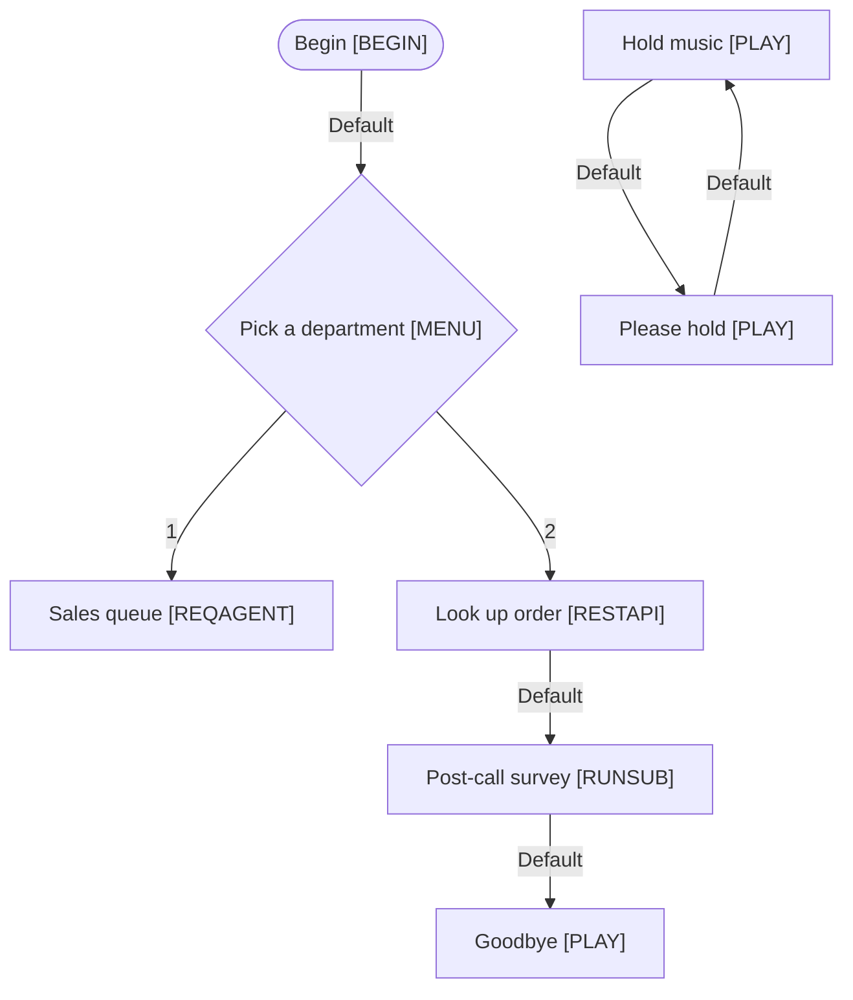

# A flow with problems

A deliberately broken script: an unreachable step, a loop with no exit, a menu with no timeout and a missing target.

Source: `test/fixtures/broken-flow.xml`

## QA check

```text
test/fixtures/broken-flow.xml: Broken Demo Flow (8 steps, 7 branches)
  HIGH  Branch points to a missing action (step #6)
        Goodbye (#6) has a "Default" branch to #99, which isn't in this file. It may be in a subscript, or the branch is broken.
  HIGH  Loop with no way out (step #8)
        Please hold → Hold music loop back on each other with no branch leaving the loop. A caller could be stuck here.
  MED   Menu has no timeout branch (step #2)
        Pick a department (#2) doesn't handle a caller who presses nothing.
  MED   Menu has no invalid-input branch (step #2)
        Pick a department (#2) doesn't handle a key that isn't a menu option.
  MED   Dead end (step #3)
        Sales queue (#3) has no outgoing branch, so the contact stops here without a hang-up or end action.
  MED   Integration has no error branch (step #4)
        Look up order (#4) calls an external system but has no branch for a failure or timeout.
  MED   Dead end (step #6)
        Goodbye (#6) has no outgoing branch, so the contact stops here without a hang-up or end action.
  MED   Unreachable action (step #7)
        Hold music (#7) can't be reached from Begin or any event. It may be left over from an earlier version.
  MED   Unreachable action (step #8)
        Please hold (#8) can't be reached from Begin or any event. It may be left over from an earlier version.
  LOW   No Default branch (step #2)
        Pick a department (#2) has no Default branch. Studio guidance is to always connect Default.

10 finding(s): 2 high, 7 medium, 1 low.
```

## Test cases (CSV)

The first rows of the CSV export. Open the full file with `studio-flow-check tests` to see every row.

```csv
"Test ID","Scenario","Preconditions","Steps","Expected path","Expected result","Script"
"TC-001","1 → Sales queue","Inbound call reaches the script","1. At ""Pick a department"", caller presses 1","#1 > #2 > #3","Caller is queued for Sales queue. Flow stops at ""Sales queue"" with no further branch","Broken Demo Flow"
"TC-002","2 → Goodbye","Inbound call reaches the script","1. At ""Pick a department"", caller presses 2
2. ""Look up order"" succeeds","#1 > #2 > #4 > #5 > #6","Flow stops at ""Goodbye"" with no further branch","Broken Demo Flow"
```

## Flowchart (Mermaid)

Paste this into any Mermaid-aware viewer to draw the flow.


