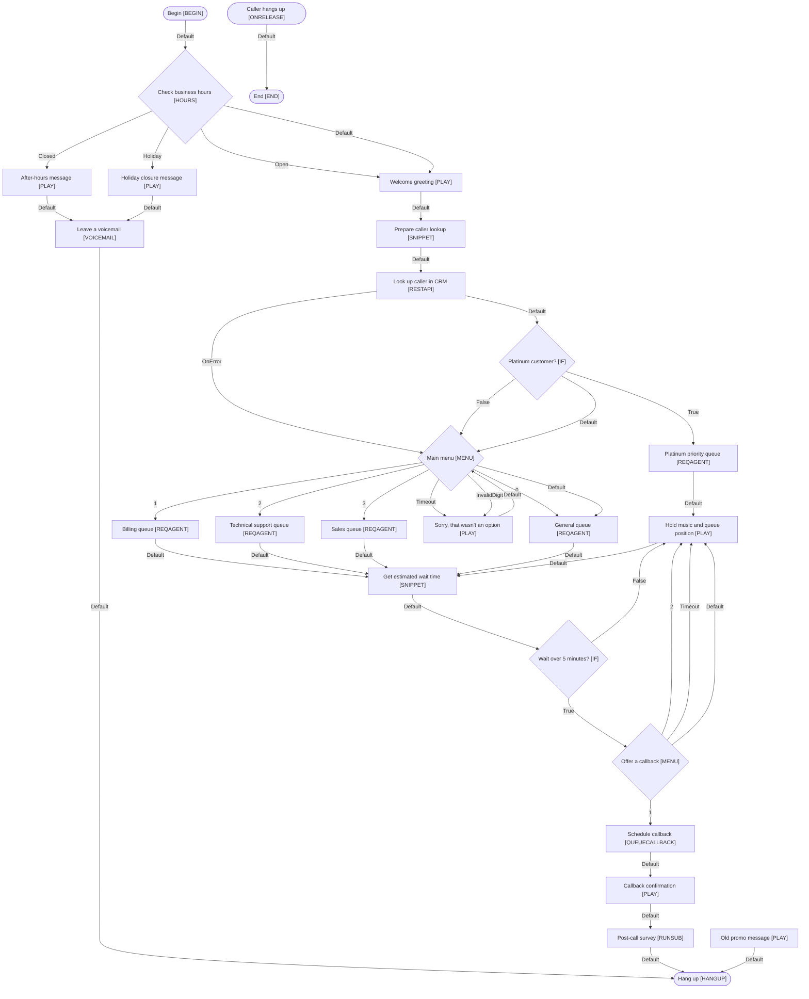

# Main inbound line (example)

The sample script that ships with the viewer: hours check, menu, CRM lookup and queue routing.

Source: `examples/main-inbound-example.xml`

## QA check

```text
examples/main-inbound-example.xml: Main Inbound Line (example) (27 steps, 41 branches)
  MED   Menu has no invalid-input branch (step #18)
        Offer a callback (#18) doesn't handle a key that isn't a menu option.
  MED   Unreachable action (step #50)
        Old promo message (#50) can't be reached from Begin or any event. It may be left over from an earlier version.
  LOW   No Default branch (step #17)
        Wait over 5 minutes? (#17) has no Default branch. Studio guidance is to always connect Default.
  LOW   Subscript not in the library (step #24)
        Post-call survey (#24) runs "PostCallSurvey", which hasn't been uploaded. Upload it to follow this step.

4 finding(s): 0 high, 2 medium, 2 low.
```

## Test cases (CSV)

The first rows of the CSV export. Open the full file with `studio-flow-check tests` to see every row.

```csv
"Test ID","Scenario","Preconditions","Steps","Expected path","Expected result","Script"
"TC-001","Closed → Hang up","Inbound call reaches the script
Hours profile state: Closed (Support - US Eastern)","1. No caller decisions on this path","#1 > #2 > #3 > #5 > #30","Caller can leave a voicemail. Call ends at ""Hang up""","Main Inbound Line (example)"
"TC-002","Open → OnError → 1 → True → 1 → Hang up","Inbound call reaches the script
```

## Flowchart (Mermaid)

Paste this into any Mermaid-aware viewer to draw the flow.


