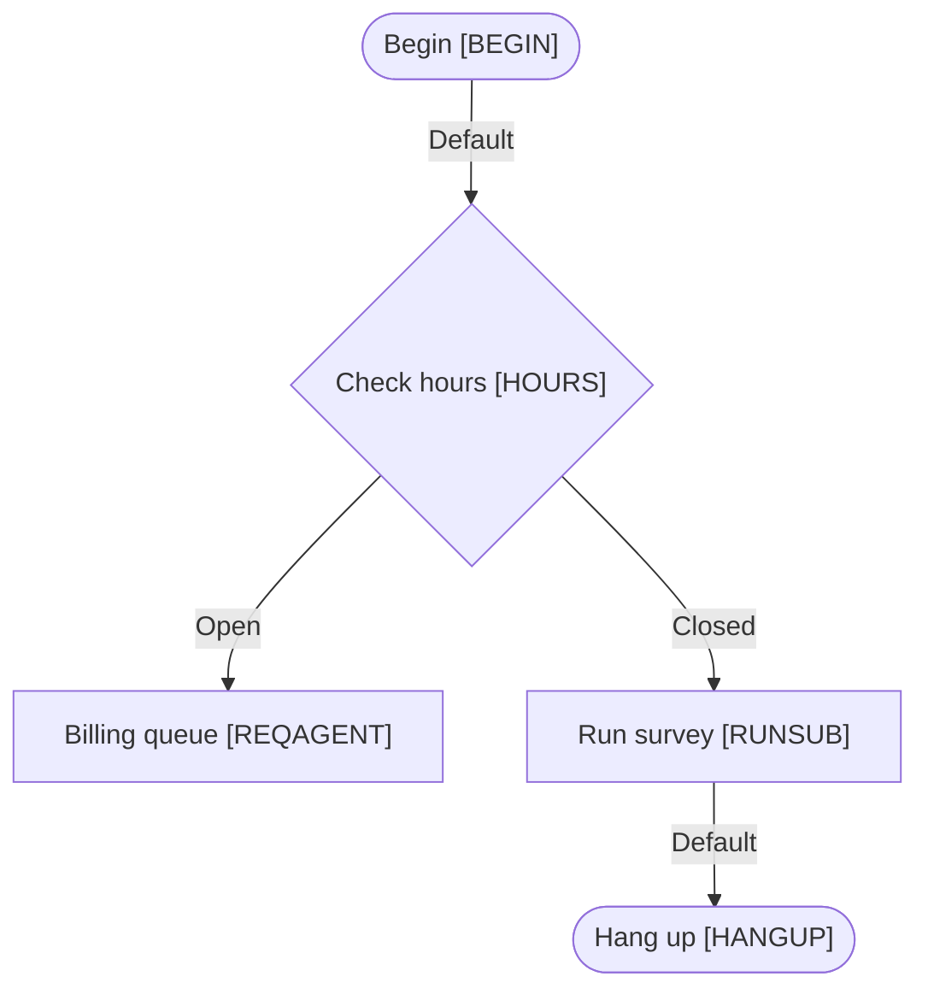

# CXone reference-list check

Skill, hours-profile and script names checked against exported CXone lists.

Source: `test/fixtures/reference-flow.xml`

## QA check

```text
test/fixtures/reference-flow.xml: Reference Check Demo (5 steps, 4 branches)
  MED   Dead end (step #3)
        Billing queue (#3) has no outgoing branch, so the contact stops here without a hang-up or end action.
  MED   Skill not in CXone reference data (step #3)
        Billing queue (#3) routes to skill "Billing", which isn't in your uploaded skills list.
  MED   Script not in CXone reference data (step #4)
        Run survey (#4) runs "Unknown Script", which isn't in your uploaded script list.
  LOW   No Default branch (step #2)
        Check hours (#2) has no Default branch. Studio guidance is to always connect Default.
  LOW   Subscript not in the library (step #4)
        Run survey (#4) runs "Unknown Script", which hasn't been uploaded. Upload it to follow this step.

5 finding(s): 0 high, 3 medium, 2 low.
```

## Test cases (CSV)

The first rows of the CSV export. Open the full file with `studio-flow-check tests` to see every row.

```csv
"Test ID","Scenario","Preconditions","Steps","Expected path","Expected result","Script"
"TC-001","Open → Billing queue","Inbound call reaches the script
Hours profile state: Open (Support - US Eastern)","1. No caller decisions on this path","#1 > #2 > #3","Caller is queued for Billing. Flow stops at ""Billing queue"" with no further branch","Reference Check Demo"
"TC-002","Closed → Hang up","Inbound call reaches the script
```

## Flowchart (Mermaid)

Paste this into any Mermaid-aware viewer to draw the flow.


